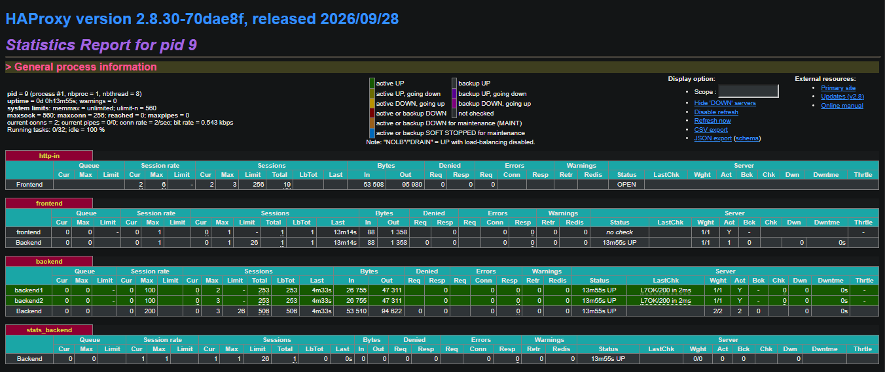
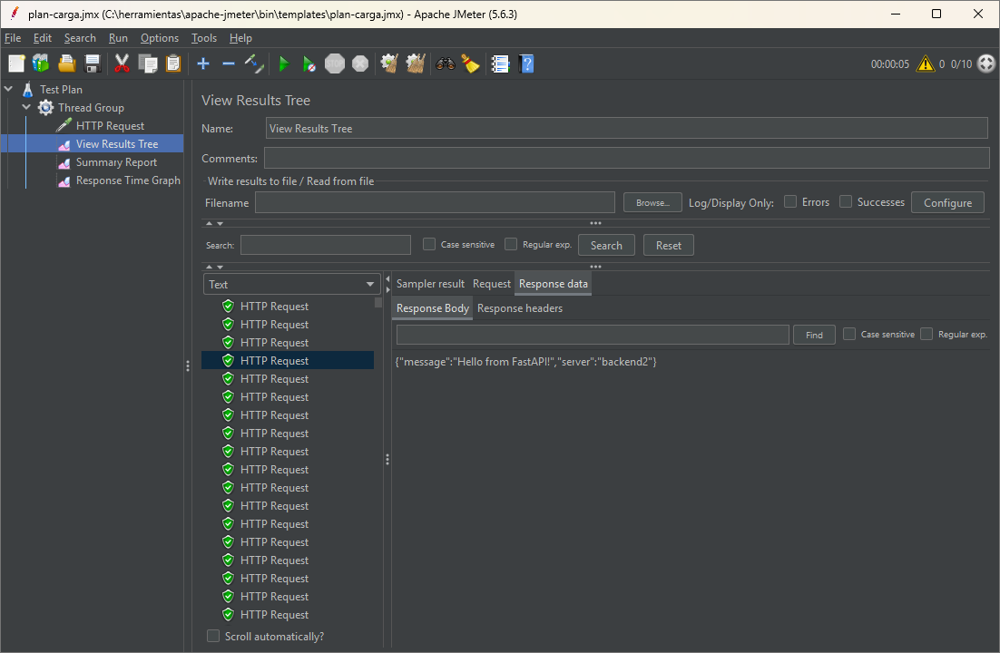
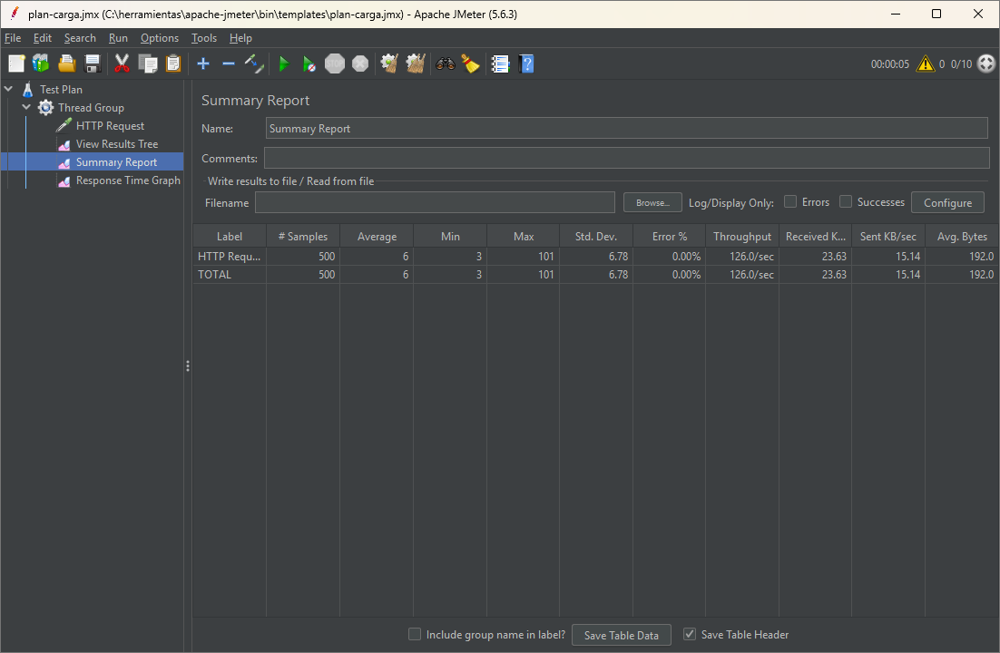
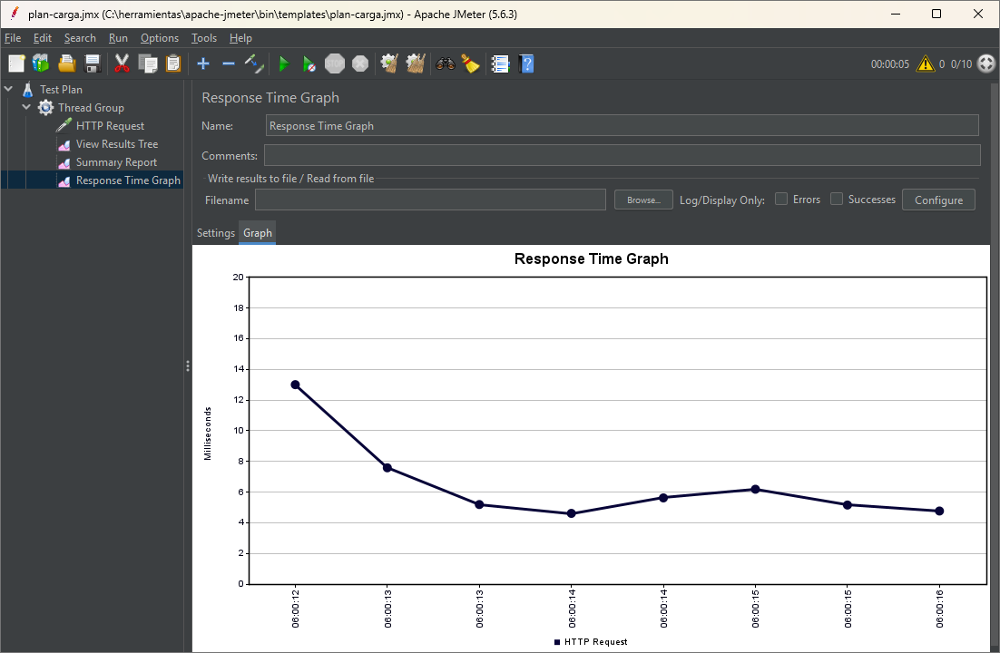
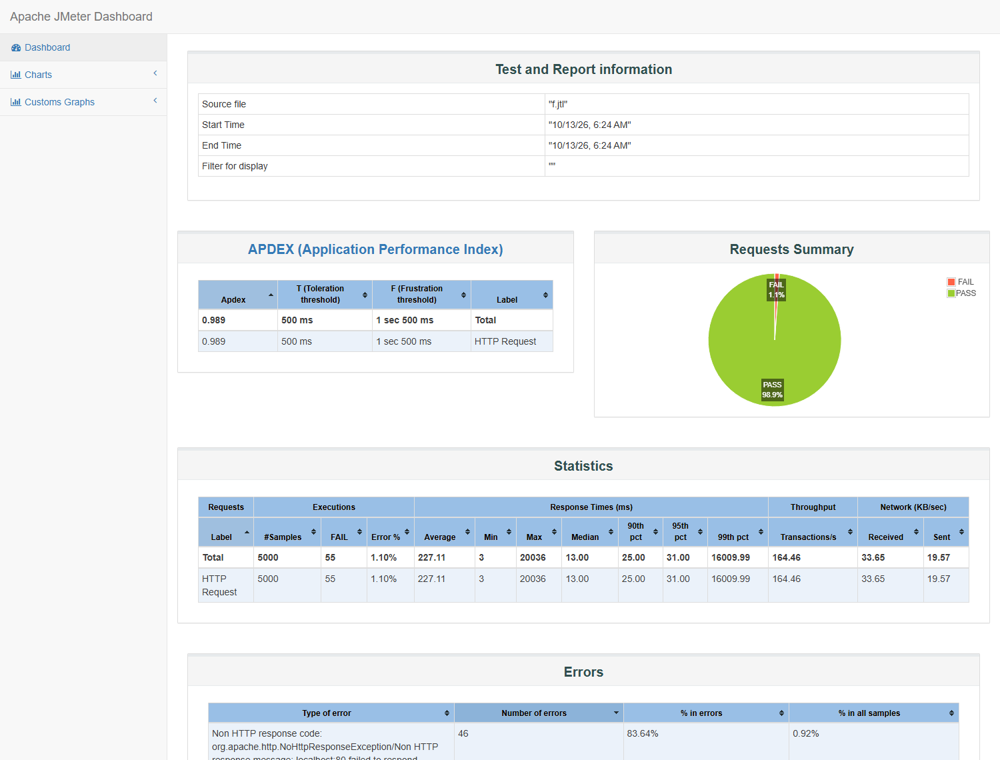

# 🧪 Challenge: Load Balancing with HAProxy + Docker + React + FastAPI + JMeter

This project is a hands-on challenge designed to help you explore containerization, load balancing, and performance testing using real-world tools.

<p align="center">
  
</p>
<p align="center">
<em>Figure 1: Architecture diagram showing HAProxy in front of backend services</em>

---

## 🎯 Objectives

You will:

1. Containerize a frontend and backend application.
2. Set up HAProxy to load balance between multiple backend instances.
3. Connect all services using Docker Compose.
4. Run the full app stack locally.
5. Design and execute load tests using Apache JMeter.

---

## 🧱 Project Structure

You are expected to create the following directory structure:

```
.
├── backend/
│   │   main.py
│   └── Dockerfile
├── frontend/
│   ├── src/
│   │   └── App.jsx
│   │   └── main.jsx
│   ├── index.html
│   └── Dockerfile
│   └── package.json
│   └── vite.config.js
├── haproxy/
│   └── haproxy.cfg
├── docker-compose.yml
└── README.md
```

You must create all missing files from scratch as part of the challenge. (dockerfile and docker-compose)

---

## 🔧 Tasks

### 1. Generate Dockerfiles

- Create a `Dockerfile` for the **backend** using Python and FastAPI.
- Create a `Dockerfile` for the **frontend** using React and Vite.
- Ensure each image exposes the correct ports and builds successfully.

---

### 2. Complete the Docker Compose Setup

- Define services for:
  - Two (or more) backend containers
  - One HAProxy container
  - One frontend container
- Configure dependencies and port mappings
- Map a custom HAProxy config file to the HAProxy container

---

### 3. Run the App Locally

- Use `docker compose up --build`
- Access the frontend through the exposed port
- Verify that the frontend communicates with the backend through HAProxy

---

### 4. Run Load Tests Using JMeter

- Design a test plan in Apache JMeter to simulate concurrent users making HTTP requests to the backend via HAProxy.
- Use different listeners such as:
  - View Results Tree
  - Summary Report
  - Response Time Graph
- Experiment with different numbers of users and request patterns.


---

## 🧠 Hints

- Use a `balance` strategy in HAProxy like `roundrobin` or `leastconn`
- Make sure all services are reachable from within the Docker network
- Keep logs and metrics to understand how HAProxy is routing traffic

---

## ✅ Deliverables

- Your completed repository with:
  - All configuration and Docker files
  - Screenshots or reports from JMeter test results

---

# Solución del reto

**Integrantes:** Victoria Herrera ([@Serendicto13](https://github.com/Serendicto13)) y Jhon Jairo Sons ([@oraboni08](https://github.com/oraboni08)).

## Cómo ejecutarlo

Requiere Docker Desktop con Docker Compose.

```bash
docker compose up --build -d
```

| Dirección | Qué muestra |
|---|---|
| http://localhost | El frontend de React, con el mensaje de la API y el backend que respondió |
| http://localhost/api/hello | La API de FastAPI, balanceada entre los dos backends |
| http://localhost/stats | El panel de estadísticas de HAProxy |

Para apagarlo: `docker compose down`.

## Qué se construyó

| Archivo | Qué hace |
|---|---|
| `backend/dockerfile` | Imagen `python:3.12-slim` que instala FastAPI y Uvicorn y sirve la API en el puerto 8000 |
| `backend/requirements.txt` | Dependencias del backend |
| `frontend/dockerfile` | Imagen `node:20-alpine` que instala las dependencias y corre el servidor de Vite en el puerto 3000 |
| `docker-compose.yml` | Cuatro servicios en la red `app-net`: `frontend`, `backend1`, `backend2` y `haproxy` |
| `haproxy/haproxy.cfg` | Enrutamiento por ruta, balanceo `roundrobin`, revisiones de salud y logs |
| `jmeter/plan-carga.jmx` | Plan de pruebas de carga |

Decisiones de diseño:

- **Una sola entrada.** Solo HAProxy publica un puerto (80). El frontend y los backends usan `expose`, así que solo son alcanzables dentro de la red de Docker y todo el tráfico pasa por el balanceador.
- **Enrutamiento por ruta.** `/api/` va al grupo de backends, `/stats` al panel de estadísticas y el resto al frontend.
- **Round robin.** Los dos backends son idénticos y las peticiones son cortas, así que repartir por turnos es lo más simple y parejo.
- **Revisión de salud.** `option httpchk GET /api/hello` con `check` en cada servidor: HAProxy saca de la rotación al backend que deja de responder y lo reincorpora cuando vuelve.
- **Balanceo visible.** La API devuelve el nombre del contenedor en el campo `server` y el frontend lo muestra como «Atendido por». Se quitó `React.StrictMode` de `main.jsx` porque en desarrollo duplica la petición y, con dos backends, la página mostraba siempre el mismo.

## Verificación del balanceo

Seis peticiones seguidas alternan entre los dos backends:

```
$ curl -s http://localhost/api/hello   (x6)
{"message":"Hello from FastAPI!","server":"backend1"}
{"message":"Hello from FastAPI!","server":"backend2"}
{"message":"Hello from FastAPI!","server":"backend1"}
{"message":"Hello from FastAPI!","server":"backend2"}
{"message":"Hello from FastAPI!","server":"backend1"}
{"message":"Hello from FastAPI!","server":"backend2"}
```

Panel de HAProxy después de una prueba de carga: 253 sesiones en cada backend, ambos en verde y con la revisión de salud en `L7OK/200`.



## Pruebas de carga con JMeter

El plan (`jmeter/plan-carga.jmx`) tiene un Thread Group, un HTTP Request a `GET http://localhost:80/api/hello` y los listeners View Results Tree, Summary Report y Response Time Graph. Usuarios, ramp-up y repeticiones son parámetros, con los valores del escenario A por defecto.

Plan en la interfaz de JMeter, con el escenario A:

| View Results Tree | Summary Report | Response Time Graph |
|---|---|---|
|  |  |  |

Los escenarios se corrieron en modo consola, cada uno por separado, generando el reporte HTML de JMeter:

```bash
jmeter -n -t jmeter/plan-carga.jmx -Jusuarios=100 -Jrampa=10 -Jrepeticiones=50 -l b.jtl -e -o reporte-b
```

### Resultados

| Escenario | Usuarios | Ramp-up (s) | Repeticiones | Peticiones | Promedio (ms) | p95 (ms) | Máx (ms) | Error % | Throughput (pet/s) |
|---|---:|---:|---:|---:|---:|---:|---:|---:|---:|
| A · Carga baja | 10 | 5 | 50 | 500 | 6.7 | 13 | 64 | 0.00 | 106.1 |
| B · Carga media | 100 | 10 | 50 | 5 000 | 18.6 | 39 | 135 | 0.00 | 486.9 |
| C · Carga alta | 300 | 15 | 50 | 15 000 | 335.2 | 942 | 1 076 | 0.00 | 481.7 |
| D · Pico repentino | 200 | 1 | 20 | 4 000 | 368.2 | 599 | 661 | 0.00 | 479.4 |
| E · Un solo backend | 100 | 10 | 50 | 5 000 | 19.3 | 33 | 96 | 0.00 | 473.9 |
| F · Caída de un backend durante la prueba | 100 | 10 | 50 | 5 000 | 227.1 | 31 | 20 036 | 1.10 | 164.5 |

En E se detuvo `backend2` antes de empezar. En F se detuvo `backend2` con la prueba en curso.

Reportes de JMeter por escenario:
[A](docs/jmeter/reporte-escenario-a.png) ·
[B](docs/jmeter/reporte-escenario-b.png) ·
[C](docs/jmeter/reporte-escenario-c.png) ·
[D](docs/jmeter/reporte-escenario-d.png) ·
[E](docs/jmeter/reporte-escenario-e.png) ·
[F](docs/jmeter/reporte-escenario-f.png)



### Conclusiones

- **El sistema tiene un techo cercano a 480 peticiones por segundo.** De 10 a 100 usuarios el throughput sube de 106 a 487 pet/s. De ahí en adelante se estanca: con 300 usuarios sigue en 482.
- **Pasado ese techo, más usuarios solo significan más espera.** El tiempo promedio pasa de 18.6 ms con 100 usuarios a 335.2 ms con 300, sin atender más peticiones por segundo.
- **Superar `maxconn 256` no produjo errores.** Con 300 usuarios el error fue 0 %; las conexiones que no caben esperan su turno, y eso se ve en el p95 de 942 ms.
- **El pico repentino se absorbe sin fallos.** 200 usuarios entrando en un segundo dieron 0 % de error, con un promedio de 368.2 ms.
- **En esta máquina, el segundo backend no aumentó la capacidad.** Con un solo backend (E) el resultado fue casi igual al de dos (B): 473.9 contra 486.9 pet/s. El límite no está en los backends. La prueba corre en un solo computador, donde JMeter, HAProxy y los contenedores comparten procesador y la red de Docker Desktop; lo más probable es que el cuello de botella esté ahí, aunque no lo medimos por separado.
- **Lo que sí aporta el segundo backend es disponibilidad.** Al tumbar `backend2` en plena prueba (F), el 98.9 % de las peticiones se atendió. Fallaron 55 de 5 000: 46 conexiones que quedaron sin respuesta y 9 respuestas 503. Algunas peticiones esperaron hasta 20 segundos.
- **La caída no se detecta al instante.** HAProxy revisa cada servidor cada 2 segundos y lo marca caído tras tres fallos seguidos. En esa ventana sigue enviándole peticiones, y de ahí salen los errores y la espera máxima. Se podría reducir con revisiones más frecuentes y tiempos de espera más cortos.
- **El reparto fue parejo.** El panel de HAProxy muestra la misma cantidad de sesiones en ambos backends.
